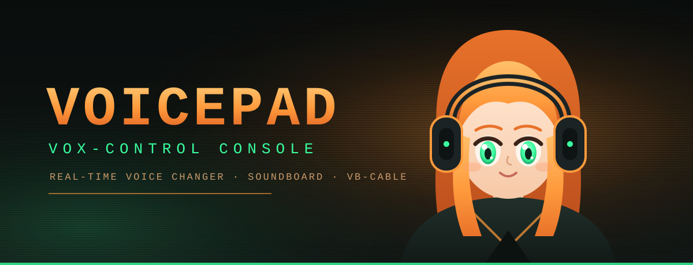

<div align="center">



**Español** &nbsp;·&nbsp; [English](README.en.md)

</div>

# VoicePad — Guía completa de uso

VoicePad es un **cambiador de voz y soundboard** para Windows (parecido a
Voicemod), con un aspecto de **consola retro-futurista** en ámbar. Lo que hace
es tomar tu micrófono, transformar tu voz y "entregarla" a un **micrófono
virtual** que Discord, los juegos, OBS, etc. usan como si fuera tu micrófono
real.

Esta guía está pensada para que la entienda alguien que **nunca** ha usado algo
así. No necesitas saber programar para utilizarla.

> ¿Solo quieres usarla? Salta a la sección **3. Tu primera vez, paso a paso**.
> Si necesitas compilarla tú mismo, ve a la sección **12**.

---

## Índice

1. Qué es y para qué sirve
2. Antes de empezar (instalar VB-Audio Cable)
3. Tu primera vez, paso a paso
4. La pantalla: cada recuadro explicado
5. Botones RESET y SAVE de cada sección
6. Perfiles: guarda y carga tus configuraciones
7. Temas de color (SKIN)
8. Redimensionar los paneles
9. Atajos de teclado
10. Dónde se guardan tus ajustes
11. Preguntas frecuentes y problemas
12. Instalar y compilar (para desarrolladores)

---

## 1. Qué es y para qué sirve

Imagina un "enchufe" entre tu micrófono y las demás aplicaciones:

```
  Tu micrófono  ──►  VOICEPAD (cambia tu voz)  ──►  CABLE Input
                                                          │
  Discord / juego / OBS  ◄── eligen  ──  CABLE Output  ◄──┘
```

- Si eliges **NORMAL**, tu voz pasa sin cambios (como un micro directo).
- Si eliges **ROBOT**, **DEMON**, **CHIPMUNK**, etc., tu voz sale transformada.
- El **soundboard** reproduce sonidos (láser, tambor…) que la otra persona
  escucha **dentro** de la misma voz.

Nada de esto se oye en tus altavoces (para evitar acoples): usa **auriculares**.

---

## 2. Antes de empezar (instalar VB-Audio Cable)

VoicePad necesita un "cable de audio virtual" gratuito llamado **VB-Audio
Virtual Cable**. Es lo que permite que tu voz procesada llegue a Discord.

1. Entra en <https://vb-audio.com/Cable/>
2. Descarga **VBCABLE_Setup_x64.exe**.
3. Ejecútalo **como administrador** (clic derecho → *Ejecutar como
   administrador*).
4. **Reinicia el ordenador.**

Después del reinicio deberías ver en Windows dos dispositivos nuevos:

- **`CABLE Input (VB-Audio Virtual Cable)`**
- **`CABLE Output (VB-Audio Virtual Cable)`**

> `CABLE Input` es *donde VoicePad escribe*. `CABLE Output` es *de donde las
> demás apps leen*. No los confundas.

---

## 3. Tu primera vez, paso a paso

1. Ejecuta **VoicePad.exe**.
2. En el panel **DEVICE ROUTING** (arriba a la izquierda):
   - Pulsa **AUTO-ROUTE**. Esto elige automáticamente tu micrófono como
     *INPUT* y `CABLE Input` como *OUTPUT*.
   - Pulsa **ENGAGE**. Verás que el panel dice **STREAM ACTIVE**.
3. En **VOICE PRESETS**, haz clic en **ROBOT** (o el que quieras). Nota cómo
   los faders de **EFFECT MATRIX** se mueven solos: así se ve cada preset.
4. Abre **Discord** (o tu juego):
   - Ajustes → **Voz y vídeo** → **Dispositivo de entrada (micrófono)** →
     elige **`CABLE Output (VB-Audio Virtual Cable)`**.
5. Habla. La otra persona debería oír tu voz con el efecto.

**Para probar sin molestar a nadie:** abre la Grabadora de Windows o Audacity,
selecciona `CABLE Output` como entrada, graba tu voz y escúchala.

> Si no quieres sorpresas, empieza con el preset **NORMAL**: debería sonar como
> tu voz normal.

---

## 4. La pantalla: cada recuadro explicado

La ventana está dividida en **paneles** (un mosaico). Cada panel tiene una
**cabecera** con su nombre y, en algunos casos, botones pequeños.

### Barra superior (arriba del todo)

- **VOICEPAD // VOX-CONTROL CONSOLE**: el nombre.
- **Lámparas de estado**:
  - `ENGINE`: verde = motor de audio activo.
  - `VOICE`: se ilumina cuando detecta tu voz.
  - `LINK`: se ilumina cuando está saliendo audio.
- **EPOCH** / **LOCAL**: contadores de tiempo.
- **SKIN**: el selector de **tema de color** (ver sección 7).
- **PROCESS: ON / BYPASS**: activa o desactiva todo el procesado. En `BYPASS`
  tu voz pasa tal cual.

### DEVICE ROUTING (arriba izquierda)

- **INPUT // MIC SOURCE**: cuál es tu micrófono.
- **OUTPUT // VIRTUAL CABLE**: dónde se entrega la voz (debe ser `CABLE
  Input`).
- **AUTO-ROUTE**: lo configura solo.
- **RESCAN**: vuelve a buscar dispositivos (si conectas un micro nuevo).
- **ENGAGE / DISENGAGE**: enciende o apaga el motor.
- Abajo: el estado del flujo y la frecuencia (`48000 HZ`).

### VOICE PRESETS (izquierda, el bloque grande)

- **8 botones** con los presets: NORMAL, FEMALE, DEEP, ROBOT, DEMON, CHIPMUNK,
  CAVE, ANIME.
- Haz clic en uno para aplicarlo.
- Debajo, una **tarjeta de detalle** muestra:
  - El nombre y la etiqueta del preset.
  - Una descripción de para qué sirve.
  - Una tabla **FACTOR / WEIGHT** con el valor de pitch, formant, drive, etc.
  - Un **EVENT TIMELINE** con los últimos cambios.

### EFFECT MATRIX (centro abajo)

Aquí afinas el sonido a mano. Cada fila es un parámetro; **arrastra el
deslizador** para cambiarlo:

| Control | Qué hace |
|---|---|
| **PITCH** | Sube o baja el tono (de grave a agudo). |
| **FORMANT** | Cambia el "grosor"/timbre (voz masculina ↔ femenina sin cambiar el tono). |
| **GATE** | Silencia el ruido de fondo cuando no hablas (actúa junto con **NOISE CANCEL**). |
| **DRIVE** | Añade distorsión/saturación. |
| **ROBOT** | Efecto metálico de robot. |
| **CHORUS** | Voz más ancha, como doblada. |
| **ECHO** | Repetición. |
| **REVERB** | Espacio (cueva, sala grande). |
| **COMP** | Compresión (iguala los volúmenes fuertes y suaves). |
| **OUT** | Volumen final de salida. |
| **DEN.** | Umbral de la cancelación de ruido, en **dB** (p. ej. −45 dB). |
| **BOARD** | Volumen de los sonidos del soundboard. |

- **NOISE CANCEL** (botón arriba del todo): activa la **cancelación de ruido**.
  Es un *gate/expansor* de puerta: **por debajo del umbral silencia el sonido**
  (ruido de fondo) y **por encima deja pasar tu voz sin tocarla**. No mete
  artefactos ni ruidos.
- **DEN.** (deslizador, en dB) = el nivel a partir del cual se deja pasar:
  - Súbelo (menos negativo, p. ej. −35 dB) si quieres que **corte más** el ruido
    de fondo (necesitarás hablar algo más fuerte).
  - Bájalo (p. ej. −55 dB) si tu voz es suave y se corta.
  - Si tu voz se corta al empezar a hablar, baja el umbral hasta que entre bien.
- **Doble clic** en un deslizador lo devuelve a la mitad (valor neutro).

### SIGNAL MAP (centro arriba)

- Un **osciloscopio** en vivo con tu voz.
- **Arrastra** para mover la vista (panear).
- **Doble clic** para hacer **zoom** (x1 ↔ x4).
- Pasa el ratón por los **marcadores numerados** (1–6) para ver su lectura.

### SOUNDBOARD MATRIX (derecha arriba)

Suena dentro de tu voz (la otra persona lo escucha). Tiene tres zonas:

- **FAVOURITES** (arriba): tus sonidos marcados como favoritos, para tenerlos a
  mano. **Clic en uno para reproducirlo.**
- **Buscador** (debajo): escribe para **filtrar la lista por nombre**. El botón
  **X** limpia la búsqueda.
- **LIBRARY** (lista completa): todos los sonidos (los 8 del kit + los que
  importes). **Clic en una fila para reproducirlo.** La barra fina de abajo
  muestra el progreso.
  - **Clic derecho** en una fila abre un menú: *PLAY*, *Add/Remove from
    favourites* y *Delete sound* (solo para sonidos importados por ti).
- **IMPORT**: añade tus propios sonidos. Se admiten varios formatos
  (**WAV, AIFF, FLAC, Ogg, MP3, WMA, M4A…**) y puedes seleccionar **varios a la
  vez**. Los sonidos importados y tus favoritos **se guardan** y siguen ahí al
  reabrir la app.
- **STOP** (o el botón RESET de la cabecera): detiene todos los sonidos.
- Los sonidos **USER** son tuyos; los **KIT** vienen incluidos.

### PROFILES (abajo derecha) — ver sección 6

- **PROFILE NAME**: escribe un nombre.
- Lista desplegable con tus perfiles guardados.
- **SAVE**: guarda la configuración actual con ese nombre.
- **LOAD**: carga el perfil seleccionado.
- **DELETE**: borra el perfil seleccionado.

### EVENT REGISTRY (derecha, tabla)

- Registro de todo lo que va ocurriendo (hora, tipo, origen, mensaje, nivel).
- **Clic en un encabezado** (TIME, TYPE, SOURCE…) para **ordenar** por esa
  columna. Otro clic invierte el orden.
- Rueda del ratón para desplazarte.

### SOURCE HEALTH (abajo, izquierda)

- Tabla con el estado de tus dispositivos: rol (CAPTURE/RENDER), estado
  (LIVE/IDLE), frecuencia, búfer y nivel (RMS en dB).
- También ordenable por columnas.

### OPERATOR MANUAL (abajo derecha)

- Ayuda rápida dentro de la propia app (solo ratón/táctil).

### Barra inferior (abajo del todo)

- Mensaje de ayuda y el estado del enlace (`LINK ESTABLISHED` / `LINK DOWN`).

---

## 5. Botones RESET y SAVE de cada sección

Muchos paneles tienen, en su cabecera, dos botoncitos:

- **RESET**: devuelve esa sección a sus valores por defecto.
  - *DEVICE ROUTING* → vuelve a auto-configurar el micrófono y el cable.
  - *VOICE PRESETS* → vuelve al preset **NORMAL**.
  - *EFFECT MATRIX* → devuelve los deslizadores a los del preset activo.
  - *SOUNDBOARD* → detiene todos los sonidos.
  - *SIGNAL MAP* → reinicia el zoom y el desplazamiento de la vista.
  - *EVENT REGISTRY / SOURCE HEALTH* → quita el orden y la selección.
- **SAVE**: guarda el estado actual de toda la app (micrófono, cable, ajustes,
  sonidos importados y favoritos) para que se **recuerde** la próxima vez que
  abras VoicePad.

> Además, al cerrar la app **se guarda todo automáticamente**.

---

## 6. Perfiles: guarda y carga tus configuraciones

Un **perfil** es una "foto" completa de VoicePad: el micrófono, el cable y
todos los ajustes de voz. Útil para tener, por ejemplo, un perfil "Discord
serio" y otro "Juego divertido".

1. Ajusta todo como quieras (preset, deslizadores, micrófono…).
2. En el panel **PROFILES**, escribe un nombre (ej. `MI PERFIL GAMING`).
3. Pulsa **SAVE**. Aparecerá en la lista.
4. Cuando quieras volver a ese estado, selecciónalo en la lista y pulsa
   **LOAD**.
5. Para borrarlo, selecciónalo y pulsa **DELETE**.

Los perfiles se guardan en un archivo y **siguen ahí** aunque cierres el
programa.

---

## 7. Temas de color (SKIN)

Arriba a la derecha, el desplegable **SKIN** cambia el color de toda la
interfaz. Temas incluidos:

- **AMBER** (ámbar, el clásico)
- **PHOSPHOR** (verde fósforo)
- **ICE** (azul hielo)
- **EMBER** (naranja brasa)
- **SAPPHIRE** (azul)
- **VIOLET** (violeta)
- **MONO** (blanco papel)

El tema elegido **se recuerda** la próxima vez que abras VoicePad.

---

## 8. Redimensionar los paneles

La ventana es un **mosaico redimensionable**. Entre los paneles hay unas
**barras finas**:

- **Arrastra** la barra **vertical** para ensanchar/estrechar las columnas.
- **Arrastra** la barra **horizontal** (encima de la fila de abajo) para
  agrandar o reducir esa fila.
- También puedes arrastrar el borde de la **ventana** para hacerla más grande.

Así puedes, por ejemplo, agrandar el **SIGNAL MAP** o el **SOUNDBOARD** a tu
gusto.

---

## 9. Atajos de teclado (opcionales)

Funcionan aunque el juego tenga el foco:

| Atajo | Acción |
|---|---|
| `Ctrl+Shift+1` … `Ctrl+Shift+8` | Aplicar el preset 1–8 |
| `Ctrl+Shift+0` | Activar/desactivar el procesado (bypass) |
| `Ctrl+Shift+S` | Detener todos los sonidos del soundboard |

> Algunos juegos con sistemas anti-trampas pueden bloquear los atajos. En ese
> caso usa la interfaz con el ratón.

---

## 10. Dónde se guardan tus ajustes

Todo vive en `%APPDATA%\VoicePad\`:

- `config.json` → tu estado actual (micrófono, cable y ajustes, incluida la
  cancelación de ruido).
- `profiles.json` → tus perfiles guardados.
- `theme.json` → el tema de color elegido.
- `sounds.json` → tus sonidos importados y tus favoritos del soundboard.

Puedes copiar esa carpeta para hacer una copia de seguridad de tus ajustes.

---

## 11. Preguntas frecuentes y problemas

**No sale `CABLE Input` / `CABLE Output`.**
Instala VB-Audio Cable como administrador y **reinicia**. Luego pulsa
**RESCAN**.

**`AUTO-ROUTE` falla.**
Casi siempre significa que VB-Cable no está instalado o no reiniciaste.

**En Discord no me oyen.**
Revisa que el micrófono de Discord sea `CABLE Output`. Y que en VoicePad el
*OUTPUT* sea `CABLE Input` y esté **ENGAGE**.

**Me oigo con eco o pitidos.**
No uses altavoces; usa **auriculares**. El eco es la voz saliendo por los
altavoces y volviendo a entrar por el micrófono.

**Se oye con retraso (latencia).**
Pon Windows a **48 kHz** (Configuración → Sonido → tu dispositivo →
Propiedades avanzadas) y un búfer bajo (256–512). Evita Bluetooth para el
micrófono.

**El juego no capta el micro virtual.**
Desactiva el "modo exclusivo" de `CABLE Output`: Panel de control → Sonido →
Grabación → `CABLE Output` → Propiedades → pestaña *Opciones avanzadas* →
desmarca *Permitir que las aplicaciones tomen control exclusivo*.

**Quiero dos configuraciones distintas.**
Usa **PROFILES** (sección 6).

**Reinicio y se me olvidan los cambios.**
Pulsa **SAVE** en la sección que cambiaste, o simplemente cierra la app (se
guarda sola).

---

## 12. Instalar y compilar (para desarrolladores)

VoicePad está hecho en **C++ / JUCE**. JUCE **no** soporta MinGW, así que hace
falta **Visual Studio con MSVC**.

### Requisitos

- **Visual Studio 2022 o 2026** con la carga *"Desarrollo para el escritorio
  con C++"* — <https://visualstudio.microsoft.com/es/vs/community/>
- **CMake** (viene con Visual Studio; si no, <https://cmake.org/download/>)
- **Git** — <https://git-scm.com/download/win>
- **VB-Audio Virtual Cable** (ver sección 2)

### Compilar

Abre **"Developer PowerShell for VS"** y ejecuta:

```powershell
cd D:\Personal-D\garcis\Proyects\voice-pad
.\build.ps1
```

- `build.ps1` detecta tu versión de Visual Studio, limpia cachés antiguas y
  compila.
- La primera vez tarda unos minutos (descarga JUCE).
- El programa resultante es:
  `build\VoicePad_artefacts\Release\VoicePad.exe`

Recompilar desde cero:

```powershell
.\build.ps1 -Clean
```

### Estructura del proyecto

```
voice-pad/
  CMakeLists.txt          Configuración (FetchContent de JUCE)
  build.ps1               Script de compilación
  README.md               Esta guía
  Assets/
    icon.png              Icono de la aplicación (exe y barra de tareas)
    header.svg            Banner mostrado en la cabecera del README
  Tools/
    make_icon.py          Generador del icono
  Source/
    Main.cpp              Punto de entrada
    MainComponent.*       Mosaico de paneles + overlay CRT + splitters
    Theme.*               Paleta y temas de color
    EventLog.h            Registro de eventos
    Config/ConfigManager.* Persistencia de estado, perfiles y librería de sonidos
    Audio/                Motor WASAPI, cadena DSP, pitch/formant, cancelación de ruido
    Soundboard/           Kit sintetizado + sonidos de usuario + favoritos
    Hotkeys/              Atajos globales (Win32)
    Presets/              Definición de presets
    Tests/                Auto-pruebas de audio offline (--selftest)
    UI/                   Paneles, LookAndFeel y widgets
    third_party/          signalsmith-stretch (+ signalsmith-linear)
```
